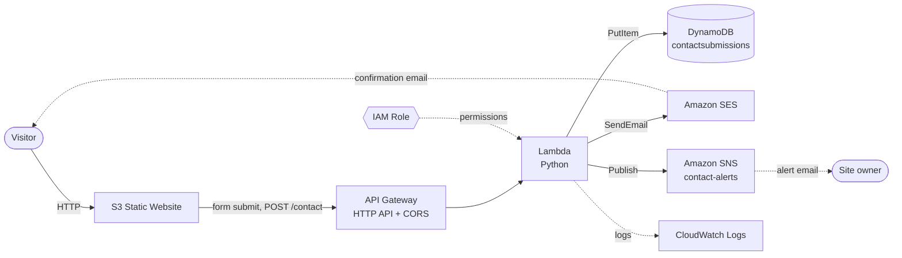
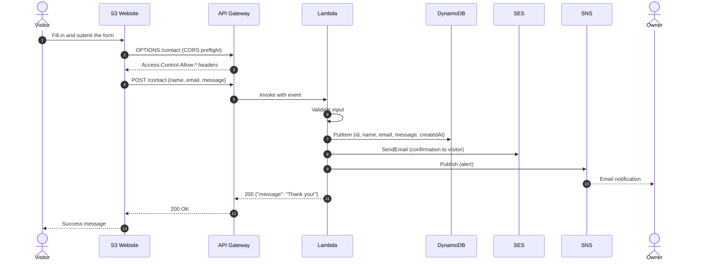

# Serverless Contact Form on AWS

A contact form built with a fully serverless architecture on AWS. Visitors submit a form on a static website hosted on **S3**; the request flows through **API Gateway** to a **Lambda** function that stores the message in **DynamoDB**, sends a confirmation email to the visitor through **SES**, and alerts the site owner through **SNS**. Permissions are managed with **IAM** and logs go to **CloudWatch**.


---

## Table of contents

- [AWS services used](#aws-services-used)
- [Architecture](#architecture)
- [Request flow](#request-flow)
- [Project structure](#project-structure)
- [Deployment guide](#deployment-guide)
- [API reference](#api-reference)
- [Security](#security)
- [Troubleshooting](#troubleshooting)
- [Roadmap](#roadmap)
- [License](#license)

---

## AWS services used

| Service | Role in this project |
|---|---|
| **Amazon S3** | Hosts the static website (single `index.html`) |
| **Amazon API Gateway (HTTP API)** | Public `POST /contact` endpoint, CORS, throttling |
| **AWS Lambda (Python)** | Validates input and orchestrates DynamoDB, SES and SNS |
| **Amazon DynamoDB** | Stores every submission (on-demand capacity) |
| **Amazon SES** | Sends a confirmation email to the visitor |
| **Amazon SNS** | Sends an alert email to the site owner |
| **AWS IAM** | Least-privilege execution role for Lambda |
| **Amazon CloudWatch Logs** | Function logs and error tracing |

Frontend: HTML, CSS and JavaScript in a single file.

## Architecture



## Request flow



## Project structure

```
aws-contact-form/
├── frontend/
│   ├── index.html            # single-file site: markup, CSS and JS (set API_URL here)
│   └── bucket-policy.json    # public-read policy for the S3 bucket
├── backend/
│   ├── lambda_function.py    # Lambda handler
│   └── iam-policy.json       # least-privilege policy for the Lambda role
├── .gitignore
├── LICENSE
└── README.md
```

## Deployment guide

All resources must be created in the **same AWS region** (this project used `us-east-1`).

### 1. DynamoDB table

- Table name: `contactsubmissions` (names are **case-sensitive**; use the exact same name in the Lambda environment variable and IAM policy)
- Partition key: `id` (String), no sort key
- Capacity mode: On-demand

### 2. SNS topic (owner alerts)

1. Create a **Standard** topic named `contact-alerts`.
2. Create a subscription: protocol **Email**, endpoint = the owner's address.
3. Click **Confirm subscription** in the email AWS sends. The status must be `Confirmed`.
4. Add more addresses the same way if several people need the alert.

### 3. SES (visitor confirmation)

1. Create an **Email address** identity for the sender and click the verification link.
2. New accounts are in the **sandbox**: mail can only be sent to verified addresses. Production access requires a verified domain and an approved request.
3. The Lambda handles SES failures gracefully, so the form still succeeds if SES rejects a recipient.

### 4. Lambda function

1. Create a function (Runtime **Python 3.x**) and paste `backend/lambda_function.py`, then **Deploy**.
2. Add environment variables:

   | Key | Value |
   |---|---|
   | `TABLE_NAME` | `contactsubmissions` |
   | `SNS_TOPIC_ARN` | ARN of the `contact-alerts` topic |
   | `SENDER_EMAIL` | SES verified sender address |

3. Attach an inline policy to the execution role using `backend/iam-policy.json` (replace `REGION`, `ACCOUNT_ID`, `TABLE_NAME`).
4. Test with this event:

   ```json
   {
     "body": "{\"name\": \"Test User\", \"email\": \"you@example.com\", \"message\": \"Hello, this is a test\"}"
   }
   ```

### 5. API Gateway (HTTP API)

1. Create an HTTP API with a Lambda integration.
2. Add route `POST /contact`, stage `$default` with **auto-deploy** on.
3. Configure **CORS**:
   - Allow-Origin: your website origin (use `*` only while testing)
   - Allow-Methods: `POST, OPTIONS`
   - Allow-Headers: `content-type`
4. Copy the **Invoke URL**. The form posts to `<Invoke URL>/contact`.

Quick test:

```bash
curl -X POST "https://YOUR_API_ID.execute-api.YOUR_REGION.amazonaws.com/contact" \
  -H "Content-Type: application/json" \
  -d '{"name":"API Test","email":"you@example.com","message":"Hello from curl"}'
```

### 6. Frontend on S3

1. Set `API_URL` in `frontend/index.html` to your Invoke URL ending in `/contact`.
2. Create an S3 bucket and turn **off** "Block all public access".
3. Upload `frontend/index.html`.
4. Enable **Static website hosting** with `index.html` as the index document.
5. Apply `frontend/bucket-policy.json` as the bucket policy (replace `YOUR_BUCKET_NAME`).
6. Open the **Bucket website endpoint** and submit the form.
7. Tighten CORS: replace `*` with the bucket website endpoint (no trailing slash).

## API reference

### `POST /contact`

**Request body (JSON)**

| Field | Type | Required | Notes |
|---|---|---|---|
| `name` | string | yes | |
| `email` | string | yes | visitor's address |
| `message` | string | yes | |

**Responses**

| Status | Body | Meaning |
|---|---|---|
| `200` | `{"message": "Thank you! Your message has been received."}` | Saved and alert sent |
| `400` | `{"message": "Name, email and message are required"}` | Missing field |
| `400` | `{"message": "Invalid JSON"}` | Malformed body |

**DynamoDB item**

```json
{
  "id": "307fa3be-3107-4fc2-...",
  "name": "Test User",
  "email": "you@example.com",
  "message": "Hello, this is a test",
  "createdAt": "2026-11-11T15:27:15.651622+00:00"
}
```

## Security

- **Least privilege:** the Lambda role only allows `dynamodb:PutItem` on one table, `ses:SendEmail`, and `sns:Publish` on one topic.
- **CORS:** `*` is used while testing; restrict Allow-Origin to the site's real origin in production.
- **Throttling:** not configured yet; recommended on the API Gateway stage (for example rate 5, burst 10) to limit abuse.
- **Spam:** consider reCAPTCHA or AWS WAF for public sites.
- **Secrets:** never commit AWS access keys. The API URL is public by design; this repository contains no credentials.
- **S3:** only public website files belong in the bucket.

## Troubleshooting

| Symptom | Cause | Fix |
|---|---|---|
| `ResourceNotFoundException ... PutItem` | Table name or region mismatch (case-sensitive) | Make `TABLE_NAME` match the table exactly |
| `Access-Control-Allow-Origin` missing in browser | CORS not applied, or page opened from `file://` (origin `null`) | Serve the page over HTTP (S3 endpoint or a local server) |
| Form works with curl, fails in browser | CORS issue | Check CORS settings and that auto-deploy is enabled |
| No visitor confirmation email | SES sandbox or unverified recipient | Verify the recipient, or request SES production access |
| No owner alert | SNS subscription still `Pending confirmation` | Confirm the subscription email |
| `403 Forbidden` on S3 website | Missing bucket policy or public access blocked | Apply the bucket policy and disable Block Public Access |

## Roadmap

- [ ] HTTPS with CloudFront
- [ ] Custom domain and SES production access
- [ ] CloudWatch alarm on Lambda errors
- [ ] Infrastructure as Code (Terraform or AWS SAM)
- [ ] CI/CD with GitHub Actions
- [ ] reCAPTCHA / AWS WAF

## License

Released under the [MIT License](LICENSE).
